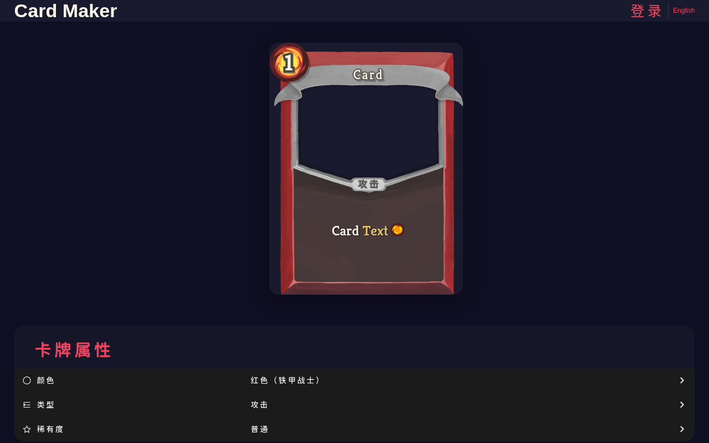

# CardDIY

以前的课程作业：一个《杀戮尖塔》风格的卡牌制作器，用 uni-app、Vue 3 和 TypeScript 编写，支持微信小程序和 H5。小程序尚未发布。

可编辑卡牌颜色、类型、稀有度、名称、能量和描述，上传自定义卡图，实时预览并导出 PNG，支持中英文切换。



运行 H5：

```sh
yarn install
yarn dev:h5
```

微信小程序：运行 `yarn dev:mp-weixin`，用微信开发者工具打开 `dist/dev/mp-weixin`，填入自己的 AppID。

描述中 `>关键词<` 显示黄色，`#数值#` 显示绿色，`@` 显示能量图标。原始课程文档保留在 [docs](docs/) 中。

卡牌素材与《杀戮尖塔》相关权利归原权利人所有。
